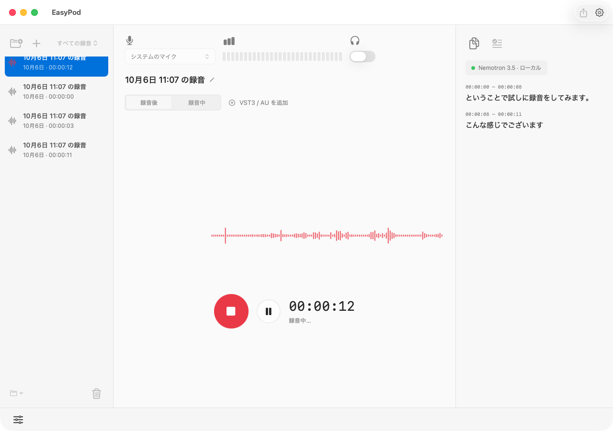
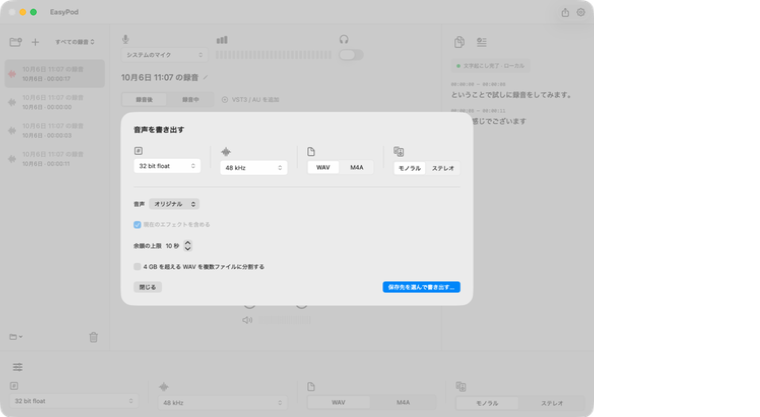

<table>
  <thead>
    <tr>
      <th style="text-align:center"><a href="README_ja.md">日本語</a></th>
      <th style="text-align:center"><a href="README.md">English</a></th>
    </tr>
  </thead>
</table>

# EasyPod

EasyPod は、macOS 26 以降の Apple Silicon Mac 向けのローカル・ポッドキャスト録音アプリです。日本語の画面で、録音、再生、エフェクト、文字起こしを操作できます。原音は float32 CAF で保存し、完成した録音を WAV または AAC/M4A で書き出せます。

文字起こしは、ローカルの Nemotron 3.5 GGUF モデルと NeMo-Speech.cpp の C ABI を使い、この Mac 上で実行します。音声を外部の文字起こしサービスへ送信しません。



*日本語の画面で録音とローカル文字起こしを行えます。*

## 主な機能

- マイクの選択、録音の一時停止・再開、ヘッドホンでのモニター。
- 波形上の再生位置、シーク、出力メーター、15秒戻る・進む操作を備えた録音再生。
- AUv2・VST3 エフェクトの追加、専用エディターの表示、並べ替え、バイパス、設定の保存。
- 録音後のエフェクト処理、または録音中の原音と処理済み音声の個別保存。
- 時刻付きのライブ文字起こし、テキストのコピー、元の文字起こしを残した録音停止後のオフライン清書。
- フォルダーでの録音整理、単数・複数の録音をごみ箱へ移動、復元。
- 保存された原音から、中断した録音を復旧。

エフェクト処理には検証が残っている項目があります。[検証状況](#検証状況)を参照してください。

## 必要な環境

- **Mac：** Apple Silicon（arm64）、macOS 26 以降。
- **ビルドツール：** Xcode 27、Swift 6.4、Git、CMake。ビルドスクリプトは `/opt/homebrew/bin` 配下の Homebrew ツールを使用します。
- **音声認識ランタイム：** C ABI ライブラリ、依存ライブラリ、ライセンス文書を含む、互換性のある NeMo-Speech.cpp のインストール。標準の場所は `~/Library/Application Support/NeMoSpeech` です。
- **文字起こしモデル：** ローカルの Nemotron 3.5 ASR Streaming 0.6B GGUF ファイル。EasyPod はモデルの同梱やダウンロードを行いません。
- **任意のエフェクト：** Mac にインストールされた、互換性のある arm64 の AUv2 または VST3 プラグイン。

XcodeGen 2.46 以降は、[project.yml](project.yml) からプロジェクトを再生成するときに必要です。通常のビルドには、リポジトリに含まれる [EasyPod.xcodeproj](EasyPod.xcodeproj) と共有 **EasyPod** スキームを使います。

NeMo ランタイムは別途用意する必要があります。NVIDIA の[インストール手順](https://github.com/NVIDIA/NeMo-Speech.cpp#installation)と[音声認識モデルガイド](https://github.com/NVIDIA/NeMo-Speech.cpp/blob/main/docs/asr/models.md)を参照してください。EasyPod は [prepare_native.sh](script/prepare_native.sh) と [embed_runtime.sh](script/embed_runtime.sh) に記載されたライブラリ・ライセンス文書の配置を前提とするため、CLI 実行ファイルだけではビルドできません。SDK を別の場所に置く場合は、ビルド時に `NEMO_SDK_ROOT` でインストール先を指定します。

## ビルドと起動

必要な環境を用意したら、リポジトリのルートで実行します。

```sh
./script/build_and_run.sh
```

スクリプトはアプリをビルドし、アドホック署名を検証したうえで `dist/EasyPod.app` に配置して起動します。操作中でない EasyPod が起動している場合はビルド前に終了し、録音中はアプリの置き換えを拒否します。Codex の **Run** も同じスクリプトを使います。このローカルビルドに Apple Developer アカウントは不要です。

初回のネイティブビルドでは、固定されたリビジョンの VST3 SDK と必要なサブモジュールを取得するため、ネットワーク接続が必要です。SDK のリビジョンは [SDK-PIN.md](Native/AudioPluginHost/SDK-PIN.md) に記載されています。ランタイムのライブラリと第三者のライセンス文書はアプリにコピーします。インストール済みのモデルやプラグインは保持し、署名するのはアプリ内のコピーだけです。

Release ビルドを配置し、起動しない場合は次を実行します。

```sh
EASYPOD_CONFIGURATION=Release ./script/build_and_run.sh --build
```

ビルドの診断ログは `build/xcodebuild.log`、`build/native-configure.log`、`build/native-build.log` に出力されます。Xcode で `EasyPod.xcodeproj` を開き、共有 **EasyPod** スキームを実行することもできます。

## はじめての録音

1. **設定 → 文字起こし**を開き、ローカルの GGUF モデルを選択します。ライブ文字起こしを使う場合は有効にしておきます。
2. **認識言語**で **オート**（自動判定）、**日本語**、**英語**を選びます。初期値は日本語です。設定は保存され、次に開始するライブ文字起こしとオフライン清書に適用されます。録音中と清書中は設定を変更できません。
3. マイクを選び、録音に名前を付けて赤い録音ボタンを押します。macOS がマイクへのアクセスを求めたら許可します。
4. 必要に応じて一時停止・再開し、停止ボタンで録音を終えます。保存された録音を再生し、シークスライダーや15秒戻る・進む操作で確認します。
5. 必要なら **清書**を実行します。設定済みのローカルモデルで保存された原音を再認識します。清書は中止でき、清書前の文字起こしに戻すこともできます。
6. **⌘E** を押して書き出し設定と保存先を選び、音声を書き出します。

エフェクトの初期設定は **録音後**です。原音を保持しながら、再生・書き出し用のエフェクトチェーンを調整できます。追加するには **VST3 / AU を追加**を使います。処理済み音声も別に保存する場合は、録音開始前に **録音中**を選びます。完成した処理済み音声を書き出すときは、保存された処理結果を使い、エフェクトを重ねて適用しません。

### キーボードショートカット

| ショートカット | 操作 |
| --- | --- |
| ⌘N | 新しい録音 |
| ⌘R | 録音の開始・停止 |
| Space | 録音の一時停止・再開 |
| ⌘P | 再生・一時停止 |
| ⌘← / ⌘→ | 15秒戻る・進む |
| ⌘E | 書き出し |
| ⌘Delete | 確認後、選択した録音をごみ箱へ移動 |

### 書き出し設定



*音声の種類、形式、品質、エフェクトの余韻を選んで書き出します。*

| 設定 | 選択肢 |
| --- | --- |
| WAV | 16-bit PCM、24-bit PCM、32-bit float |
| AAC/M4A | 96、128、192、256 kbps |
| サンプルレート | 44.1、48 kHz |
| チャンネル | モノラル、ステレオ |
| エフェクトの余韻の上限 | 0〜30秒、初期値は10秒 |

初期設定は WAV、24-bit、48 kHz、モノラルです。原音に現在のエフェクトを含めるかどうかを選べるほか、録音中に処理が完了した音声も書き出せます。4 GB を超える WAV は複数ファイルに分割できます。書き出しは一時ファイルを経由し、完成したファイルを確定します。

## 保存場所と復旧

録音は `~/Library/Application Support/EasyPod/Sessions` に保存されます。各録音は、固定された UUID のディレクトリを持ちます。

- `source.caf` — float32 の原音。
- `processed.caf` — 録音中にエフェクトを適用した場合の別保存音声。
- `session.json` — 録音のメタデータ、エフェクト設定、文字起こしの状態。
- `transcript.json` — 文字起こしの復旧用コピー。

フォルダーへの割り当ては `.library-index.json` に保存します。ごみ箱への移動は、録音のディレクトリ全体を録音ライブラリ内の `.Trash/<UUID>` に移します。**ごみ箱**から **録音を戻す**を選ぶと復元できます。フォルダーを削除しても、録音は未分類として残ります。

中断した録音は原音を保持し、復旧操作を表示します。未完成の処理済み音声は、完成した処理済み音声として書き出す選択肢に表示しません。

## 検証状況

[PLANS.md](PLANS.md) に検証の記録と残りの確認項目をまとめています。実際の日本語音声、文字起こし時刻の進行、時間を測った一時停止・再開、修正後の短い混合エフェクト録音における原音と処理済み音声の位置合わせ、実録音からの16/24/32-bit float WAV と96/192 kbps AAC の書き出しに検証記録があります。保存済み音声を使う対象を絞ったテストでは、ライブストリームとオフライン認識の両方で、日本語・英語・自動判定を確認しています。

エフェクト処理の検証項目 **I6/V3** は未完了です。複数形式のプラグインを組み合わせた、より広い処理・障害の組み合わせなどが残っています。画面全体の目視確認と VoiceOver による操作確認は、未実施の推奨確認事項です。プラグインの音声処理はアプリのプロセス内で実行します。スキャナーヘルパーが分離するのは VST3 の検出だけであり、音声処理側のクラッシュでアプリが終了する場合があります。

実装の詳細と変更履歴は [NOTES.md](NOTES.md) と [CHANGELOG.md](CHANGELOG.md) を参照してください。
